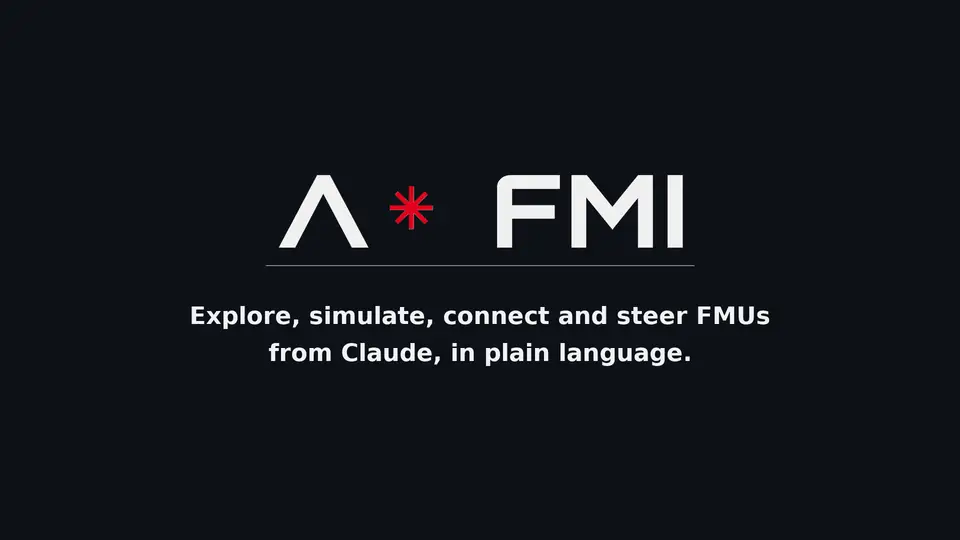
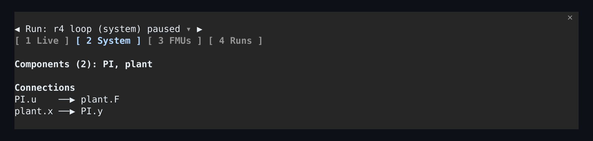
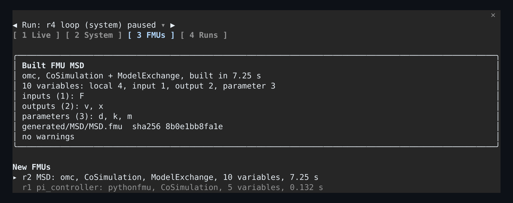
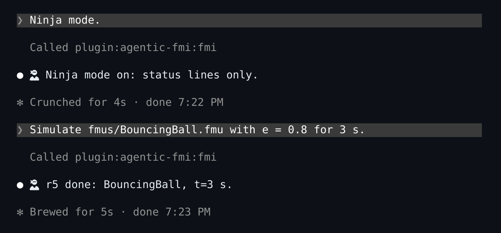

<p align="center">
  <picture>
    <source media="(prefers-color-scheme: dark)" srcset="docs/images/logo-dark.png">
    
  </picture>
</p>

<h3 align="center">Explore, simulate, connect and steer FMUs from Claude, in plain language.</h3>

<p align="center">
  <a href="LICENSE"></a>
  
  
  
  
</p>

Agentic FMI turns Claude Code into a simulation assistant for [FMI](https://fmi-standard.org/) models (FMUs). Ask in plain language: inspect an FMU, simulate and compare runs, build new FMUs from Python or Modelica, connect them into systems and exchange those as [SSP](https://ssp-standard.org/) files, and steer a live simulation while a pane inside Claude Code charts it. Claude reads compact results (metrics and plots), decides the next experiment and acts again.

<p align="center"></p>

## What you can do

| Ask Claude | What happens |
|---|---|
| *"What FMUs are in this folder? Inspect BouncingBall."* | Interfaces, variables with units, tunable parameters and whether each FMU runs here. |
| *"Simulate it with e = 0.5 and e = 0.8, compare and plot the height."* | Two runs, a comparison of what changed and one plot. Compact summaries, never raw data dumps. |
| *"Write a PI controller in Python and a mass-spring-damper in Modelica."* | Claude writes the sources, builds FMI 2.0 FMUs and tests them. |
| *"Connect them in a closed loop and tune Kp and Ki for less than 5 % overshoot."* | A system co-simulated with OMSimulator, tuned run by run. |
| *"Export the tuned loop as tuned.ssp with its parameters." / "Import plant.ssp and run it."* | SSP and SSV import and export, so systems and parameter sets move to and from other SSP tools. |
| *"Start the loop live, step it, then set Kp to 8 while it runs."* | A live run you and Claude steer together, charted in the pane (`/fmi`). |
| *"Show me an example."* | A ready-made model that ships with the plugin, built and run in seconds. Nothing is downloaded. |
| *"Talkative mode."* | Claude explains every result. The default, ninja mode, answers a run with one line: `🥷 r12 done: BouncingBall, t=3 s.` |

## Quick start

### Option A: the dev container (recommended)

Everything is preinstalled: Claude Code, Python, uv, FMPy, OMSimulator and OpenModelica. You need Docker, Git and a Claude account. The first build downloads the tools (the image is about 2.3 GB).

```bash
git clone https://github.com/MechC-ODE/agentic-fmi.git
cd agentic-fmi
docker compose up -d --build
docker exec -it agentic-fmi-dev claude      # log in once, then /exit
```

Get some FMUs into the scratch workspace `/lab`: your own with `docker cp my_model.fmu agentic-fmi-dev:/lab/`, or the free [Reference FMUs](https://github.com/modelica/Reference-FMUs):

```bash
docker exec -w /workspace agentic-fmi-dev bash -lc 'uv run python scripts/fetch-reference-fmus.py && mkdir -p /lab/fmus && cp .cache/reference-fmus/0.0.41/3.0/*.fmu /lab/fmus/'
```

Then start Claude Code with both plugins in `/lab`:

```bash
docker exec -it -w /lab agentic-fmi-dev claude --plugin-dir /workspace --plugin-dir /workspace/pane
```

In Git Bash on Windows, put `MSYS_NO_PATHCONV=1` in front of `docker exec` commands that use `-w`, so `/lab` isn't rewritten into a Windows path.

### Option B: install the plugins in your own Claude Code

On Linux x86-64 or WSL 2, with [Claude Code](https://docs.claude.com/en/docs/claude-code) (and a Claude account) and [uv](https://docs.astral.sh/uv/) installed:

```bash
claude plugin marketplace add MechC-ODE/agentic-fmi
claude plugin install agentic-fmi@agentic-fmi
claude plugin install agentic-fmi-pane@agentic-fmi   # optional: the live pane
```

Start Claude Code in a folder with FMUs, or in an empty one and ask for an example. The first start sets up the plugin's Python environment with uv (once, a minute or two). Building FMUs from Modelica also needs [OpenModelica](https://openmodelica.org/) (`omc`) on the path.

### First prompts

> Show me an example.

> What FMUs are in this folder?

> Simulate BouncingBall with e = 0.5 and e = 0.8, compare the runs and plot the height.

Type `/fmi` to open the live pane. The [user guide](docs/user-guide.md) walks through every task.

## The live pane

`/fmi` opens a pane next to the conversation. It follows the run store, so it shows what Claude starts, and its buttons steer the same runs Claude does.

<table>
  <tr>
    <td width="50%"></td>
    <td width="50%"></td>
  </tr>
</table>

- **Live:** state and progress, Pause, Resume (at a speed), Step, Stop and Set, current values grouped by component, and up to three live charts: click a signal to chart it.
- **System:** a system run's components and connections.
- **FMUs:** cards for the FMUs you built, with their interface and build provenance.
- **Runs:** every run, one click to open it. Keys **1** to **4** switch tabs.

## Ninja or talkative

Replies are short by default (ninja mode): runs, builds and live-control steps come back as one status line. Say *"talkative mode"* and Claude explains every result, until you say *"ninja mode"*.

<p align="center"></p>

## How it works

<p align="center"></p>

- **An MCP server** gives Claude 18 tools. It reads only `modelDescription.xml` and never loads FMU binaries.
- **Each run gets its own worker process**, which runs the FMU's native code with [FMPy](https://github.com/CATIA-Systems/FMPy) (single FMUs) or [OMSimulator](https://github.com/OpenModelica/OMSimulator) (connected systems), with a heartbeat, a timeout and a kill switch.
- **A file-based run store** (`.agentic-fmi/` in your workspace) records every run's settings, the FMU's hash and tool versions, so results are reproducible. The pane reads it and writes only its commands.

Details: [architecture](docs/architecture.md) and [the run-store protocol](docs/protocol.md).

## Requirements and limits

- FMI 2.0 and 3.0, Co-Simulation and Model Exchange. FMI 1.0 and Scheduled Execution are not supported.
- FMUs need Linux x86-64 binaries. Windows-only FMUs are reported as not runnable.
- Live control needs Co-Simulation. Up to four runs at a time.
- SSP import takes flat systems (one level of components); nested systems, parameter mappings (SSM) and signal dictionaries are refused by name. Exports use SSD 1.0 where it suffices and SSD 2.0 when the system needs it (for example an FMI 3.0 component).
- FMUs run native code. Agentic FMI isolates it from the server, but it is not a sandbox: use FMUs you trust.
- The pane uses an early-access Claude Code extension API and may need updates as Claude Code evolves.

## Documentation

| Read | For |
|---|---|
| [User guide](docs/user-guide.md) | Every task, with prompts and what to expect |
| [Architecture](docs/architecture.md) | Components, data flow and design principles |
| [Development](docs/development.md) and [testing](docs/testing.md) | Working on the code in the dev container |
| [Codebase map](docs/codebase-map.md) | What each module does and where to start |
| [Decisions](docs/adr/README.md) | Why the design is the way it is |
| [Changelog](CHANGELOG.md) | What changed |

## Contributing

Issues and pull requests are welcome. Start with [CONTRIBUTING.md](CONTRIBUTING.md): the dev container, the checks to run and how contributions are licensed.

## License

Agentic FMI is free for noncommercial use, such as research, teaching, study and personal projects, under the [PolyForm Noncommercial License 1.0.0](LICENSE). Commercial use needs a separate license: please [open an issue](https://github.com/MechC-ODE/agentic-fmi/issues) or contact [MechC-ODE](https://github.com/MechC-ODE).

Copyright © 2026 Ahmed Attia.

## Acknowledgements

Built on [FMPy](https://github.com/CATIA-Systems/FMPy), [OMSimulator](https://github.com/OpenModelica/OMSimulator), [pythonfmu](https://github.com/NTNU-IHB/PythonFMU), [OpenModelica](https://openmodelica.org/), the [MCP Python SDK](https://github.com/modelcontextprotocol/python-sdk) and the [Modelica Reference FMUs](https://github.com/modelica/Reference-FMUs). FMI is a standard of the [Modelica Association](https://modelica.org/).
