# 0004. OMSimulator as the multi-FMU orchestrator

**Status:** Accepted, partly superseded by [0009](0009-systems-with-omsimulator.md) · **Date:** 2026-10-09

> **Changed by 0009:** no `Instance` protocol (each engine is one function); OMSimulator is a core dependency pinned by a hash of its files; the worker steps with `doStep` and the result file off.

## Problem

Connected FMUs, such as a controller and a plant, need a master algorithm that wires them, coordinates their steps and imports and exports SSP. Live runs also need to step a system one step at a time.

## Decision

OMSimulator 3 runs connected FMUs, pinned exactly (`3.0.0.post198`); FMPy keeps running single FMUs. Both sit behind one engine seam. Spike (c) confirmed OMSimulator 3 can step a system and set values between steps.

## Options considered

| Option | Verdict | Why |
|---|---|---|
| **OMSimulator 3** | Chosen | SSP-native, Python API, can step |
| FMPy container FMUs | Rejected | No SSP; spike (d) only partly worked |
| Our own master algorithm | Rejected | Scope creep |

## Trade-offs

**Gains**
- Standard SSP and SSV exchange with other tools.
- One engine seam, two real implementations, shared contract tests.

**Costs, and how we handle them**
- OMSimulator changes quickly: exact pin plus contract tests.
- It prints to stdout and allows one model per process, so it runs only in workers.
- Its source package downloads an unhashed binary; [0009](0009-systems-with-omsimulator.md) pins the installed files.

<b>Details:</b> the API spike (c) confirmed, and known pitfalls

- **High level:** `inst = SSP(path).instantiate()`, then `setResultFile`, `setValue(CRef(...), v)`, `initialize()`, then any mix of `stepUntil(t)`, `doStep()`, `setValue`, `getValue` and `getTime()`, then `terminate()` and `delete()`. There is no legacy `OMSimulator` class in this version.
- **Low level:** `from OMSimulator import Capi` wraps the native `oms_*` calls. Never call `Capi.getResultFileSignals`: it segfaults.
- **One model per process:** `InstantiatedModel` hard-codes the model name, so a second `instantiate()` fails.
- **FMI 3.0 Binary signals** in the result file leave it empty and make every step about 50 times slower ([0009](0009-systems-with-omsimulator.md) turns the result file off).
- **The PyPI source package** downloads a nightly tarball from `build.openmodelica.org` with `verify=False`, so `uv.lock` doesn't cover the binary.
- **pythonfmu FMUs** run in OMSimulator and FMPy without `LD_PRELOAD`, because the FMU bundles its own `pythonfmu`; only hosts that aren't Python need `LD_PRELOAD` of libpython (spike (e)).

