# 0005. Pane as a separate early-access plugin

**Status:** Accepted, amended by [0010](0010-live-runs-and-the-pane.md) · **Date:** 2026-10-09

> **Changed by 0010:** the pane doesn't read `events.jsonl` (toasts come from state changes and command outcomes), and it also reads `spec.json`, `build.json` and `outcomes/`.

## Problem

Users want to watch and steer a run without asking Claude for every update. Claude Code's mod API can draw panes, charts and toasts and poll files, but it is early access and other MCP clients don't have it.

## Decision

The pane is a separate, optional plugin, `agentic-fmi-pane`, opened with `/fmi`.

- It only reads run-store files and writes command files ([0003](0003-file-based-run-store-protocol.md)).
- It never calls Python or the server, holds no business logic and never wakes Claude.
- Every pane action has an MCP tool that does the same, so the core works without it.

## Options considered

| Option | Verdict | Why |
|---|---|---|
| **A separate plugin over the store** | Chosen | API changes stay in `pane/`; the core stays portable |
| The pane inside the core plugin | Rejected | Ties the core to an early-access API |
| No pane | Rejected | Users would ask Claude for every update |

## Trade-offs

**Gains**
- Mod API changes stay inside `pane/`.
- Testable alone with `claude plugin test pane` and fixture stores.

**Costs, and how we handle them**
- A TypeScript reader duplicates the pydantic models; generated schemas, fixtures and a drift test keep them in step.
- Two plugins to install for the live view.
- Edits over a Windows bind mount need `/reload-plugins`.
