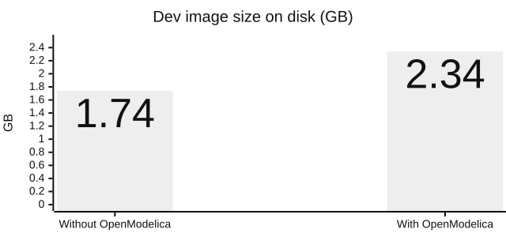

# 0006. Dedicated dev container on Ubuntu 24.04

**Status:** Accepted · **Date:** 2026-10-09

## Problem

Development happens on Windows 11, but FMUs run Linux-first, OpenModelica ships through apt for Ubuntu LTS, and the pane needs Claude Code in the same environment. Every developer and agent must run the same commands the same way.

## Decision

A dedicated image on `ubuntu:24.04`, run as the container `agentic-fmi-dev`.

- Inside: Claude Code (pinned), Python 3.12 with uv, Node, build tools, a non-root user, and OpenModelica (on by default).
- The repository is mounted at `/workspace`; the login, Python environment, caches and `/lab` live in volumes.
- All tooling runs through `docker exec`.

## Options considered

| Option | Verdict | Why |
|---|---|---|
| **A dedicated container** | Chosen | Reproducible, disposable, the same for everyone |
| A WSL distribution | Rejected | Configured by hand, hard to reset |
| An existing, unrelated image | Rejected | Unrelated tooling couples two projects |

## Trade-offs

**Gains**
- The same environment for every developer and CI; no Python on the host.
- Pinned Claude Code, so the pane's API changes only when we bump it.

**Costs, and how we handle them**
- Docker Desktop is required.
- Windows bind mounts are slow, so the environment lives in a volume and demos run in `/lab`.
- Git Bash needs `MSYS_NO_PATHCONV=1`, and the host path has a space.
- OpenModelica adds 0.6 GB (`WITH_OPENMODELICA=0` leaves it out), and its pinned apt version must be bumped when the repository drops it.

<b>Details:</b> the image and the container

- **Image** (`.devcontainer/Dockerfile`): Node 24 copied from `node:24-bookworm-slim`; Claude Code installed with npm, pinned by `CLAUDE_CODE_VERSION` (bumps need a rebuild); uv 0.11 copied from `ghcr.io/astral-sh/uv` with uv-managed Python 3.12; build tools; user `dev` (uid 1000).
- **OpenModelica**: `omc` and the Modelica Standard Library from the official apt repository, pinned by `OPENMODELICA_VERSION`, behind `WITH_OPENMODELICA` (default `1`). It grows the content size from 520 MB to 692 MB, about 135 MB of download. A rebuild fails with "version not found" once the repository drops the pinned build. The repository key isn't checked against a known fingerprint.
- **Container** (`compose.yaml`): service `dev`, container `agentic-fmi-dev`, `init: true` (reaps zombies), `sleep infinity`. Volumes `claude-home`, `venv`, `uv-cache` and `lab`. `devcontainer.json` serves VS Code users.
- **Windows notes:** bind mounts may not deliver file-change events, so plugin edits need `/reload-plugins`; quote the host path.

