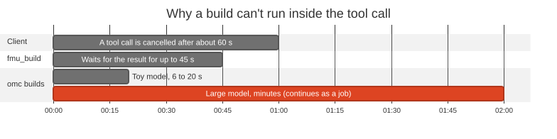

# 0008. FMU builds: one fmu_build tool, supervised build jobs, build.json provenance

**Status:** Accepted · **Date:** 2026-10-10

## Problem

Claude writes a model in Python or Modelica and needs it built into an FMU.

- **Builds can outlast a tool call.** A small Modelica model takes 6 to 20 s, a large one minutes, but some MCP clients cancel a call after about 60 s.
- **Building runs the user's code.** pythonfmu imports the source; `omc` compiles C.
- **The compilers are awkward.** `omc` exits 0 even when it fails, scatters side files, and needs CVODE for usable Co-Simulation.

## Decision

One tool, `fmu_build(source, name?, overwrite?, wait_s?)`. Every build is a job in the run store.

- `.py` builds FMI 2.0 Co-Simulation with pythonfmu; `.mo` builds FMI 2.0 Model Exchange and Co-Simulation with `omc` and CVODE.
- Claude writes the source with its own file tools, so the user sees it before the build.
- The ordinary worker runs the build: heartbeat, stop, timeout (30 min) and takeover all apply.
- `fmu_build` waits up to 45 s, then returns the run ID for `run_status`.
- Success writes `generated/<name>/<name>.fmu` plus `build.json` (source hash, tool versions, FMU hash); failure returns short `file:line` errors.

## Options considered

| Option | Verdict | Why |
|---|---|---|
| **One tool, builds as run-store jobs** | Chosen | One entry point; reuses tested supervision |
| One tool per language | Rejected | Two tools to learn, no gain |
| A subprocess inside the tool call | Rejected | Long builds hit the 60 s cutoff |
| A separate build worker or queue | Rejected | Runs already have all the machinery |

## Trade-offs

**Gains**
- Builds of any length; stop, timeout and crashes reuse tested code.
- Errors Claude can fix with a small edit.
- Every generated FMU carries its provenance, which the pane shows.

**Costs, and how we handle them**
- **Isolation, not a sandbox:** the build runs as the user, with network access. The user reviewing the source and approving `fmu_build` is the trust boundary.
- pythonfmu FMUs need CPython 3.12 wherever they run; `omc` FMUs are Linux x86-64 only.
- **Known gap:** if a worker dies on its own, its build tool can be left running. A fix is planned.

<b>Details:</b> validation, isolation, outputs, diagnostics and edge cases

- **More compiler facts** (spikes (e) and (f)). pythonfmu builds only FMI 2.0 Co-Simulation and imports the source to read its `Fmi2Slave` class; its FMUs run in our Python-hosted engines without `LD_PRELOAD`. `omc` reports errors only through `getErrorString()` (with harmless `Error:` lines even on success when offline), writes seven side files into its working directory, offers FMI 2.0 only, integrates Co-Simulation with forward Euler unless built with `--fmiFlags=s:cvode`, and needs a writable `HOME`.
- **Validation before any job or subprocess.** The source resolves (symlinks too) inside the workspace, outside the store and `generated/`; an outside path is refused without revealing whether it exists. It must be a regular UTF-8 file of at most 256 KiB, read once and hashed.
  - A `.py` must contain `Fmi2Slave`, and its stem must be an identifier that is no keyword, not in `sys.stdlib_module_names` and not importable, because pythonfmu and the FMU's host import it by that name.
  - A `.mo` stem must name a `model` or `block` in the file (a text search), and `omc` must be on `PATH` (otherwise an install hint).
  - `name` (default: the stem) matches `^[A-Za-z][A-Za-z0-9_]{0,63}$`, isn't a Windows reserved name, doesn't collide with a `generated/` entry by case only, and isn't being built by another job.
- **Isolation.** The worker builds a private copy (`runs/<id>/source/`) in `runs/<id>/work/` (working directory and `TMPDIR`, removed afterwards). Tools run with argv only, stdin from `/dev/null`, output to `build.log`, and an allowlisted environment (`PATH`, `HOME`, `LANG`, `OPENMODELICA*`, fixed `PYTHON*` values, our `TMPDIR`), in the worker's process group. We never call `pythonfmu deploy`, `installPackage` or `updatePackageIndex`; ruff TID251 bans importing `pythonfmu` in `src/`. `omc` gets its proxy variables set to the unroutable `http://127.0.0.1:9`, so it can't download libraries.
- **Atomic output.** Success is decided from the tool's own result, then the FMU's `modelDescription.xml` is checked. Under the store lock, with the watchdog disarmed, the worker re-checks the output folder and writes the FMU, then `build.json`, each by temporary file and `os.replace`, appends one `fmu_built` event and writes `finished`. `overwrite=true` replaces only a folder that holds a readable `build.json`.
- **Diagnostics.** At most 2000 characters: a count line and at most 10 lines `path:line[:col]: error: message`, errors first, with the workspace-relative path and no temporary path, internal traceback frame or ANSI escape; then the path of `build.log`.
- **Protocol (additive, still version 1).** `BuildSpec`, `BuildRecord` and `BuildEvent` (`type: "fmu_built"`), `ErrorCode.BUILD_FAILED`, `IndexEntry.kind = "build"`. A build's `status.json` reuses the run fields (`t = 0`, progress 0 until done); `fmu_build` publishes no output schema, to save `tools/list` space.
- **Edge cases.** A worker killed between the two `os.replace` calls leaves an FMU whose `build.json` is missing or stale; readers compare `fmu.sha256`. Two servers can briefly start builds of one name; the commit re-checks under the store lock, so the later one fails cleanly. Builds count toward `max_workers` and compile inside the store, so keep it on a Linux filesystem. pythonfmu FMUs also need the slave's own imports, and `LD_PRELOAD` of `libpython3.12.so` in a host that isn't Python. The orphan gap exists because the supervisor only kills the process group of a live pid.
- **Follow-ups.** Concurrent first-time OpenModelica library installs into one `HOME` are untested. A named volume for `~/.openmodelica` (it saves a 154 MB copy per recreated container) waits for the next planned image rebuild.

