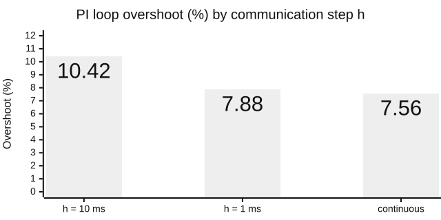

# 0009. Systems with OMSimulator: one run path, SSP and SSV as exchange formats, a pinned install

**Status:** Accepted, amended by [0010](0010-live-runs-and-the-pane.md) · **Date:** 2026-10-10

> **Changed by 0010:** the gate becomes `gate(t, live)` with a `Live` handle (`get`, `set`) in both engines; live specs gate once at the start time; both engines report discarded and terminated steps alike.

## Problem

Claude connects FMUs into systems and exchanges them with other tools as SSP (systems) and SSV (parameter sets). The spikes on OMSimulator 3.0.0.post198 found four obstacles:

- **The step size changes the answer.** Components exchange values once per step (Jacobi coupling), which adds up to one step of delay around a loop. The chart shows one PI loop at three step sizes; at 100 ms it goes unstable.
- **OMSimulator's own SSP handling is unreliable:** exports aren't reproducible, parameter precedence is reversed, and running users' SSP files would put untrusted XML in the worker.
- **The install is unverified:** its source package downloads binaries without a hash, and plugin installs got no OMSimulator at all.
- **Side effects:** a result file in the working directory unless turned off, logs on stdout, one model per process.

## Decision

- **One run path.** Claude writes a JSON system file (or imports one). `run_start(system=...)` resolves it into a `SystemSpec`, and the worker builds the model through OMSimulator's API, stepping with `doStep()`, with the result file off. Results match FMPy's, so plots and comparisons are shared.
- **SSP and SSV are exchange formats, handled by the server, never by OMSimulator.** `system_import` reads a flat `.ssp` safely; `system_export` writes a byte-identical `.ssp`; parameter sets are `.ssv` files.
- **A pinned install.** OMSimulator is a core dependency, pinned by a hash of its installed files; server and worker refuse a changed install.
- **Engine seam:** each engine is one function, `simulate(spec, directory, gate)`.
- **Three tools:** `system_check`, `system_import`, `system_export`. The `tools/list` cap rises from 26,000 to 32,000 bytes.

Parameters come in layers; a later layer wins: **FMU start values → system file → `.ssv` parameter set → `start_values` in `run_start`**.

> **Review rule for `ssp.py`:** no zip member name ever reaches a filesystem path. The import reads only members the SSD references, through `ZipFile.open`, and names every file it writes itself. Any change that extracts a member under its archive name needs a new security review.

## Options considered

| Option | Verdict | Why |
|---|---|---|
| **Build the model from our own system file** | Chosen | One run path; untrusted XML never reaches the worker |
| Run users' SSP files with `SSP(path)` | Rejected | Two run paths, untrusted XML, OMSimulator's SSP bugs |
| A `system_define` tool | Rejected | Claude writes files itself, in view of the user |
| An `Engine` class and `Instance` protocol | Rejected | Two plain functions are enough |

## Trade-offs

**Gains**
- Every system run is reproducible from its `spec.json`, and the pane draws its diagram from it.
- Untrusted SSP files never reach OMSimulator; exports are reproducible.
- Plugin installs get OMSimulator, and a changed install is caught before any FMU runs.

**Costs, and how we handle them**
- **Choose the step size consciously:** Jacobi coupling adds up to a step of delay.
- The pin matches the Ubuntu 24.04 build; other platforms fail it until someone reviews and updates it.
- The first plugin start downloads OMSimulator's binary without TLS verification; the docs describe doing it once, up front.
- Out of scope: Gauss-Seidel coupling, variable steps, nested systems, SSM, signal dictionaries, unit conversion, input signals for systems.

<b>Details:</b> the spikes, the system file, import and export rules, the pin and engine quirks

**Spike facts.** `stepUntil(t)` can overshoot by a step, so the engine uses `doStep()`. `getValue()` after `doStep()` returns post-exchange values (a connected input equals its source output); with two pythonfmu FMUs in one process the result matched the exact zero-order-hold Jacobi recurrence to 2.4e-15. Without `setResultFile("")` after `instantiate()`, OMSimulator writes `default_res.mat` into the working directory (`removeSignalsFromResults(".*")` alone doesn't stop it), and FMI 3.0 Binary variables slow every step 50-fold. Each `instantiate()` leaks a temporary folder. OMSimulator applies component-level bindings after system-level ones, while SSP 1.0 section 5.2.3 says the higher level wins, and it loses a component-level SSV next to an inline binding on re-export. The 1 ms overshoot is 7.88 % through the real engine (7.84 % for the ideal sampled-data model).

**System file v1 (JSON).** `{"version": 1, "components": {name: {"fmu", "parameters"}}, "connections": [{"from", "to"}], "experiment": {"start_time", "stop_time", "step_size"}}`. Unknown keys are refused; at most 256 KiB; component names match `^[A-Za-z_][A-Za-z0-9_]{0,63}$`; `<component>.<variable>` splits at the first dot; FMU paths are relative to the system file and must resolve, symlinks included, inside the allowed roots; `step_size` is required. `run_start` picks the outputs (default: every component's outputs). Schema: `docs/schemas/system-file.schema.json`, with a drift test.

**The run.** Exactly one of `fmu` and `system`. For systems, `output_interval` is h, and `inputs`, `fmi_type`, `solver` and `relative_tolerance` are refused. The worker verifies the pin, copies each FMU into `work/fmus/` while hashing it, sets `TMPDIR` to `work/tmp`, and builds the model with `addResource`, `addComponent`, `addConnection`, a fixed-step solver and `setValue` before `initialize()`. A run is refused if its result table exceeds `Limits.system_max_cells` (5 million cells, about 100 MB) unless `force` is set. Contract tests run both engines through real workers; a test-only check loads our exports with `SSP(path)` and compares the results.

**Import.** `system_import(source, name?)` writes `imported/<name>/<name>.json` plus private copies `imported/<name>/<component>.fmu`; SSV values become parameters, with SSP 1.0 precedence and a warning per overridden value.
- Reads only SSD-referenced members through `ZipFile.open`, with streamed caps per member and in total. It first reads the end-of-central-directory record and refuses more than 1000 declared entries or an oversized central directory, then checks the count again after opening.
- Refuses duplicate names, encryption, other compressions, absolute, `..`, backslash or URI references, `sourceBase="component"` and any DOCTYPE (lxml with no entities, DTD or network). Nested systems, SSM, signal dictionaries, system-level connectors and connection transformations are refused by name.
- Stages the result, runs the system checks there and passes on at most five warnings; a system with errors is still imported, so `system_check` can fix it. A missing stop time or step gets a default with a warning. Renames the staging folder once and never replaces anything.

**Export.** `system_export(system, dest, paramset?)` is byte-identical on repeat: sorted entries, fixed timestamps, each FMU stored once, one `resources/parameters.ssv`, the step as OMSimulator's annotation, each FMU's sha256 in an `org.agentic-fmi` annotation. It writes SSD 1.0, or 2.0 when an FMI 3.0 connector type needs it; both validate against OMSimulator's bundled XSDs, and re-imports gave identical results. Enumerations travel as `Integer`; no units are written.

**Pin.** `oms_pin.py`, outside `engines/`, hashes the installed `OMSimulator/` tree (sorted relative paths plus each file's sha256, `__pycache__` skipped) without importing it; the pin is `config.OMSIMULATOR_PIN`. The worker checks against both `spec.omsimulator` and its own copy and fails closed with `oms_changed`. This detects a changed install; it doesn't prove where the bytes came from. Ruff TID251 bans `OMSimulator` imports outside `engines/`.

**Engine quirks.** OMSimulator's clock always starts at 0, so system runs must too. A discarded step stalls the clock without an error, so the engine fails a step that makes no progress. A pythonfmu slave that raises aborts the worker, so the run ends as `worker_lost` with the abort in its log. Two pythonfmu FMUs with the same module name are refused by `system_check`.

**Protocol (additive, still version 1).** `SystemSpec`, `ErrorCode.OMS_CHANGED`, and `kind: "system"` in `IndexEntry`, `RunView` and `RunListItem`. Measured `tools/list`: 29,460 bytes for 16 tools.

**Residual exposure, not introduced here.** FMPy unpacks an FMU's `modelDescription.xml` without a size cap, so a hostile FMU can make the server read a very large XML. Add a cap in `fmu/inspect.py` if FMUs from untrusted sources become a use case.

