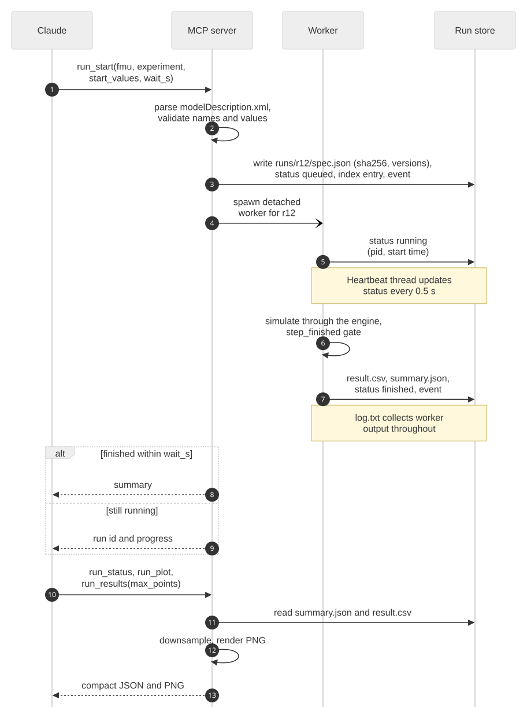
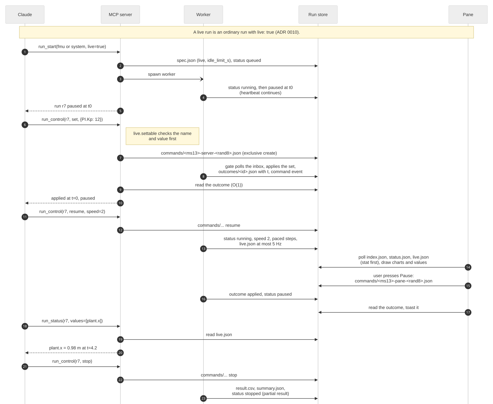

# Architecture

How Agentic FMI fits together, for someone seeing it for the first time. When you want more detail, the [codebase map](codebase-map.md) explains every module, the [protocol](protocol.md) every file format, and the [decision records](adr/README.md) the reasons behind the design.

## The big picture

There are four parts:

1. **Claude Code with the plugins.** You talk to Claude. The core plugin gives Claude the FMI tools and the skills that explain how to use them.
2. **The MCP server.** Claude's toolbox. It answers tool calls, reads FMU descriptions, starts simulations and summarizes the results. It never runs an FMU's code itself.
3. **Workers.** One separate process per run. This is where the FMU's code actually runs: with FMPy for a single FMU, with OMSimulator for connected FMUs.
4. **The run store.** A folder in your workspace, `.agentic-fmi/`, where everything about each run is written down: its settings, status, results and plots.

The optional **pane** shows the run store live inside Claude Code and writes commands into it. The server, the workers and the pane never talk to each other directly; they only read and write files in the run store.

## What happens when you run a simulation

1. You ask for a simulation, and Claude calls `run_start`.
2. The server checks the request: the FMU exists and runs on this machine, the parameter names are real, and the run will finish in reasonable time. Then it creates a folder for the run with its settings.
3. The server starts a worker process for the run.
4. The worker loads the FMU and simulates. While it works it updates a heartbeat; at the end it writes the result table and a summary into the run's folder.
5. Claude gets a short summary back. Plots, comparisons and numbers come later from the saved results, so nothing has to run again.

If something goes wrong, the run still ends cleanly: a worker that crashes or hangs stops updating its heartbeat and is shut down, and a run that takes too long hits its timeout. Either way the run is marked failed with the reason and the end of its log.

## Other things you can do

**Build an FMU.** Claude writes a Python or Modelica source file with its normal file tools, so you see it before anything runs. `fmu_build` then compiles it in a worker, just like a run: pythonfmu for Python, OpenModelica for Modelica. The new FMU lands in `generated/<name>/` next to a `build.json` that records how it was made. If the build fails, Claude gets the compiler messages and fixes the file.

**Connect FMUs into a system.** A small JSON file lists the FMUs, which output feeds which input, and the communication step. `system_check` checks it, and `run_start(system=...)` runs it in a worker with OMSimulator. Systems can be exported to and imported from SSP files, the standard exchange format for connected FMUs. Good to know: connected FMUs exchange values once per communication step, which adds up to one step of delay around a loop, so the step size can change the result.

**Steer a live run.** A live run is a normal run that starts paused and can be controlled while it goes:

- Commands (pause, resume at a speed, step, set a value, stop) are small files written into the run's folder, by the server when Claude asks or by the pane's buttons.
- Between steps the worker picks up each command, applies it and writes an answer file, so every command is accounted for.
- Several times a second the worker also writes the current values and their recent history to `live.json`, which the pane draws and Claude can read.

## Design rules, and why

| Rule | Why |
|---|---|
| FMU code runs only in workers, never in the server | A crashing or hanging FMU can't take Claude's tools down with it |
| Tools return summaries and plots, never raw data | Claude's context stays small, so long sessions stay focused and affordable |
| Every run records its settings, the FMU's fingerprint (sha256) and the tool versions | Any result can be reproduced and compared |
| The parts talk only through the run store's files | The server, workers and pane stay independent, and the file formats are [documented](protocol.md) |
| Input files are never changed | Built FMUs, systems and parameter sets are always new files |
| Both simulators plug in through the same small interface | FMPy and OMSimulator are interchangeable for everything after the simulation, and the same tests check both |

## Security in short

- FMUs and generated FMUs are programs: they run with your permissions. Workers keep them away from the server, but they are not a sandbox, so use FMUs you trust.
- The tools never download anything.
- Claude writes build sources with its normal file tools, so you see the code before a build runs.
- Originals are never overwritten, SSP files are treated as untrusted input, and the OMSimulator installation is checked against a known fingerprint before it is used.

## Inside the code

The Python package splits into a **server side** (the MCP tools and what they call), a **worker side** (the worker and the two simulation engines) and **shared modules** used by both. One rule holds it together: the server side never imports the worker side, so the server can't load an FMU's code by accident. A lint rule and a test enforce this. The [codebase map](codebase-map.md) goes through the modules one by one.

## Key decisions

| ADR | Decision |
|---|---|
| [0001](adr/0001-mcp-server-as-integration-layer.md) | An MCP server is the integration layer |
| [0002](adr/0002-isolated-worker-process-per-run.md) | Each run gets its own worker process |
| [0003](adr/0003-file-based-run-store-protocol.md) | The parts share state through a file-based, versioned run store |
| [0004](adr/0004-omsimulator-as-multi-fmu-orchestrator.md) | OMSimulator runs connected FMUs |
| [0005](adr/0005-pane-as-separate-early-access-plugin.md) | The pane is a separate, optional plugin |
| [0006](adr/0006-dedicated-dev-container-ubuntu-24-04.md) | Development happens in a dedicated container |
| [0007](adr/0007-run-store-location-ids-and-supervision.md) | Where the run store lives, how runs are named and how workers are supervised |
| [0008](adr/0008-fmu-builds-as-supervised-jobs.md) | Building an FMU is a supervised job, like a run |
| [0009](adr/0009-systems-with-omsimulator.md) | Connected systems: one way to run them, SSP for exchange, a checked OMSimulator install |
| [0010](adr/0010-live-runs-and-the-pane.md) | Live runs are ordinary runs controlled through command files; the pane reads only the run store |
