# Development

Everything runs inside a Docker container, so your computer only needs Docker and Git. This page shows how to set it up, the commands you'll use every day, how to try your changes in Claude Code, and where to look when something goes wrong.

## Set up once

From the repository folder on your computer:

```bash
docker compose up -d --build
docker exec -it agentic-fmi-dev claude      # log in once, then /exit
docker exec -w /workspace agentic-fmi-dev bash -lc 'uv sync --locked'
```

The first build downloads the tools (the image is about 2.3 GB), and the first `uv sync` takes a minute because it builds OMSimulator. Both are one-time costs.

On Windows in Git Bash, put `MSYS_NO_PATHCONV=1` in front of `docker exec` commands that contain paths like `/workspace`; PowerShell doesn't need it.

## Everyday commands

Run these inside the container, in `/workspace`. From your computer, wrap one in `docker exec -w /workspace agentic-fmi-dev bash -lc '...'`, or open a shell with `docker exec -it agentic-fmi-dev bash`.

| To | Run |
|---|---|
| Run the tests | `uv run pytest -q` (add `-m "not omc"` to skip the slower Modelica builds) |
| Check style and types | `uv run ruff check .`, `uv run ruff format --check .`, `uv run mypy` |
| Format the code | `uv run ruff format .` |
| Check the plugins | `claude plugin validate .` and `claude plugin validate pane` |
| Test the pane | `claude plugin test pane` |
| Get the Reference FMUs | `uv run python scripts/fetch-reference-fmus.py` (downloads about 3 MB into `.cache/`) |
| Add or upgrade a dependency | edit `pyproject.toml`, then `uv lock` and `uv sync --locked` |

## Try your changes in Claude Code

Start Claude Code in the scratch workspace `/lab` with both plugins loaded from your working copy:

```bash
docker exec -it -w /lab agentic-fmi-dev claude --plugin-dir /workspace --plugin-dir /workspace/pane
```

Then talk to it as a user would (the [user guide](user-guide.md) has prompts to try) and type `/fmi` for the pane. After you edit plugin files, run `/reload-plugins`; for the pane, also type `/fmi` again. Changes to the Python code are picked up by new runs; restart Claude Code to reload the MCP server itself.

## Where things are kept



| In the container | What it is | Kept when the container is recreated? |
|---|---|---|
| `/workspace` | Your repository, shared with your computer | Yes, it's your folder |
| `/lab` | A scratch workspace for trying things out | Yes (a Docker volume) |
| `/home/dev/.claude` | Your Claude Code login and settings | Yes (a Docker volume) |
| `/home/dev/.venvs/agentic-fmi` | The Python environment | Yes (a Docker volume) |

Each workspace you use gets its own run store, `.agentic-fmi/`, with one folder per run.

## When something goes wrong

| Problem | Where to look |
|---|---|
| A run failed | The run's folder `.agentic-fmi/runs/<id>/`: `status.json` has the error, `log.txt` the FMU's messages and the full traceback, `spec.json` exactly what was run |
| Claude doesn't see the FMI tools | `/mcp` in Claude Code. To see why the server won't start, run it by hand: `CLAUDE_PLUGIN_ROOT=/workspace sh /workspace/scripts/afmi-mcp /lab </dev/null` and read the error |
| A live run seems stuck | In its folder: the `state` and `last_cmd` in `status.json`, and the newest files in `commands/` and `outcomes/`. A command without an answer means the worker is gone or still busy |
| Leftover worker processes | `ps -eo pid,cmd \| grep "agentic_fmi worker"`. Stop a run with `run_stop`, or ask Claude to |
| The pane shows nothing | Start Claude Code in the folder that holds `.agentic-fmi/`, or set `AFMI_STORE_DIR` |
| A test fails | `uv run pytest -x --pdb path/to/test.py` stops at the first failure in the debugger |

## Working on the pane

The pane is TypeScript in `pane/`, loaded by Claude Code as a plugin. It only reads the run store and writes command files.

- **Test it with** `claude plugin validate pane` and `claude plugin test pane`. The tests are the only type check in the container, so cover every branch you add.
- **Test data** comes from `pane/fixtures/store.ts`, which is generated: after changing a file format in Python, run `uv run python scripts/pane_fixtures.py` and commit the result. Never edit it by hand.
- **Look at it** in a real session too (see [Try your changes](#try-your-changes-in-claude-code)): the tests can't show how it looks.

## Diagrams

The diagrams in these docs are images made from small text files, so they display everywhere.

1. Edit the source in `docs/diagrams/<name>.mmd` ([Mermaid](https://mermaid.js.org/) syntax).
2. On your computer (not in the container), run `sh scripts/render-diagrams.sh`. The first time, add `--pull` to download the renderer image (about 600 MB).
3. Commit the `.mmd` and the `.svg` together.

Add `--png .cache/diagrams-check` to also get PNGs you can look at before committing.

## Reference

The details below are for when you need them.

<details>
<summary><b>The container image</b></summary>

| Part | Version |
|---|---|
| Base | Ubuntu 24.04 |
| Claude Code | pinned in the Dockerfile (`CLAUDE_CODE_VERSION`) |
| Python | 3.12, installed by uv; there is no system Python |
| uv | 0.11 |
| OpenModelica | `omc` and the Modelica Standard Library, pinned by `OPENMODELICA_VERSION` |
| User | `dev` (uid 1000), not root |

- **Without OpenModelica:** `WITH_OPENMODELICA=0 docker compose build` makes the image about 0.6 GB smaller; Modelica builds and their tests are then unavailable.
- **When the OpenModelica version disappears** from its package repository, the image build fails with "version not found". Bump `OPENMODELICA_VERSION` in the Dockerfile.
- **The OpenModelica repository key** is downloaded at build time and its fingerprints are printed to the build log, but they are not checked against a known value.
- **OMSimulator** builds from a source package that downloads its binaries without a checksum. Agentic FMI therefore checks the installed package against a known fingerprint and refuses to run systems if it changed ([ADR 0009](adr/0009-systems-with-omsimulator.md)). The fingerprint matches the Ubuntu 24.04 build.

</details>

<details>
<summary><b>Rebuilding and resetting</b></summary>

| Goal | Command (on your computer) |
|---|---|
| Rebuild after changing the Dockerfile | `docker compose up -d --build` (your volumes are kept) |
| Get a newer Claude Code | `docker compose build --no-cache && docker compose up -d` |
| Reset the Python environment | `docker compose down && docker volume rm agentic-fmi_venv && docker compose up -d`, then `uv sync --locked` |
| Reset everything | `docker compose down -v` (this also deletes your login and `/lab`) |

VS Code users can also open the folder with **Dev Containers: Reopen in Container**.

</details>

<details>
<summary><b>Windows notes</b></summary>

- **Paths in Git Bash:** Git Bash rewrites arguments like `/workspace` into Windows paths. Put `MSYS_NO_PATHCONV=1` in front of `docker exec`.
- **"The input device is not a TTY":** use `winpty docker exec -it ...`, or Windows Terminal or PowerShell.
- **Line endings:** the repository uses LF everywhere (`.gitattributes`). A shell script saved with CRLF fails in Linux with `bash\r: No such file or directory`.
- **File changes:** changes made on Windows may not trigger reloads in the container; run `/reload-plugins` after editing plugin files.
- **Git:** commit from your computer's git rather than inside the container.

</details>

<details>
<summary><b>Inside a run's folder</b></summary>

| File | What it holds |
|---|---|
| `spec.json` | Everything the run was asked to do: the FMU and its sha256, the experiment, parameters, inputs, outputs, timeout |
| `status.json` | The state (`queued`, `running`, `paused`, `finished`, `stopped`, `failed`), the time reached, the heartbeat, and the error if any |
| `log.txt` | Everything the worker and the FMU printed, including the full traceback of a failure |
| `result.csv`, `summary.json` | The results and their summary (finished or stopped runs) |
| `plots/` | The plots made from this run |
| `commands/`, `outcomes/` | Live runs: each command and the worker's answer to it |
| `live.json` | Live runs: current values and the recent history of the charted signals |

The exact formats are in the [protocol](protocol.md).

</details>

<details>
<summary><b>Re-running a run by hand</b></summary>

To reproduce a run outside Claude, copy its folder, set the copy back to `queued`, and start a worker on it. The worker prints the FMU's output to your terminal:

```bash
cp -r .agentic-fmi/runs/r7 .agentic-fmi/runs/r900
uv run python - <<'EOF'
from pathlib import Path
from agentic_fmi.store import runstore
from agentic_fmi.store.protocol import RunState, RunStatus, utc_now
run = Path(".agentic-fmi/runs/r900")
old = runstore.read_status(run)
runstore.write_status(run, RunStatus(run_id="r900", state=RunState.QUEUED, t_start=old.t_start,
                                     t_stop=old.t_stop, updated_at=utc_now()))
EOF
uv run afmi worker .agentic-fmi/runs/r900; echo "exit $?"
```

Ctrl+C stops it the way `run_stop` would, keeping the partial result. If the FMU file changed since the run was created, the worker refuses with `fmu_changed`.

</details>

<details>
<summary><b>Sending a live-run command by hand</b></summary>

Write the command under a temporary name, then rename it, so the worker never reads a half-written file:

```bash
cd .agentic-fmi/runs/r8
id=$(date +%s%3N)-server-00000000
echo "{\"protocol\":1,\"id\":\"$id\",\"source\":\"server\",\"issued_at\":\"$(date -u +%Y-%m-%dT%H:%M:%SZ)\",\"action\":\"step\",\"n\":1}" > commands/.tmp
mv commands/.tmp commands/$id.json; sleep 1; cat outcomes/$id.json
```

</details>

<details>
<summary><b>How stuck workers are cleaned up</b></summary>

The server checks a run whenever a tool asks about it, and once when it starts:
- A running or paused run whose worker process is gone, or whose heartbeat is more than 5 s old, is shut down and marked `failed` with the reason `worker_lost` and the end of its log.
- A run that is still `queued` after 15 s is marked failed: its worker never started.
- A run past its timeout is ended by the worker itself (`failed` with `timeout`).

The details are in [ADR 0007](adr/0007-run-store-location-ids-and-supervision.md).

</details>
