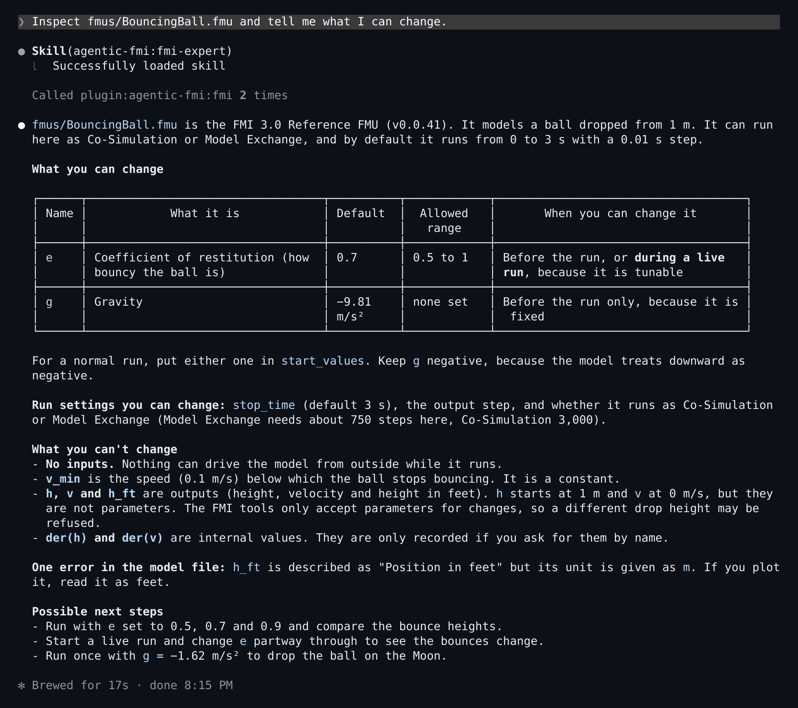
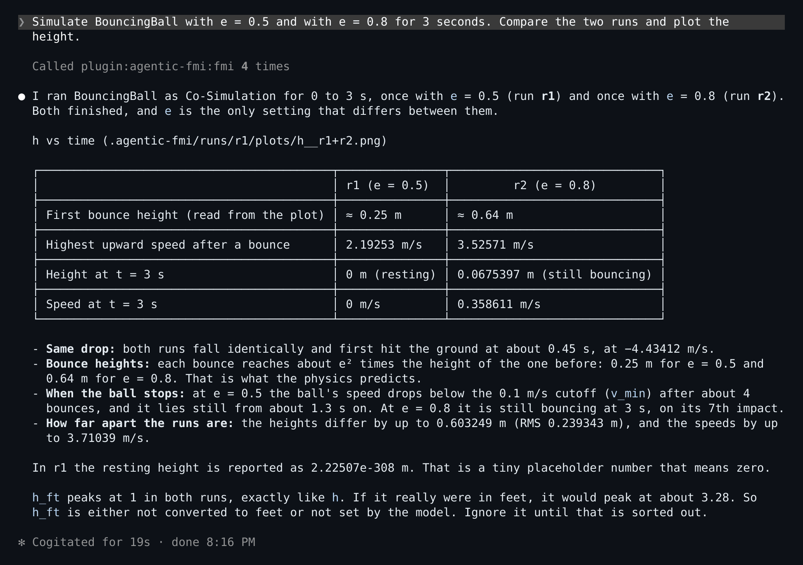
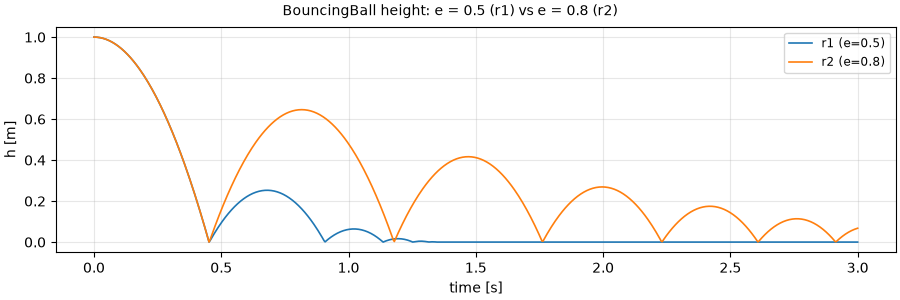
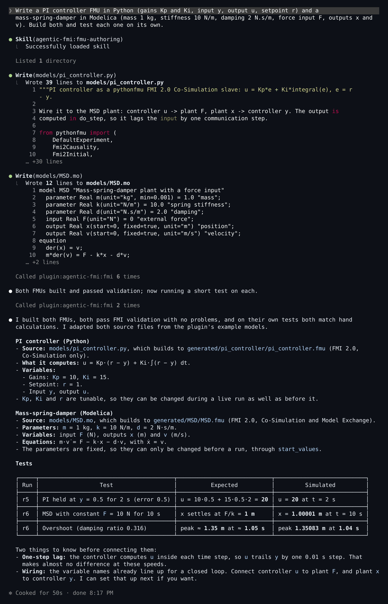
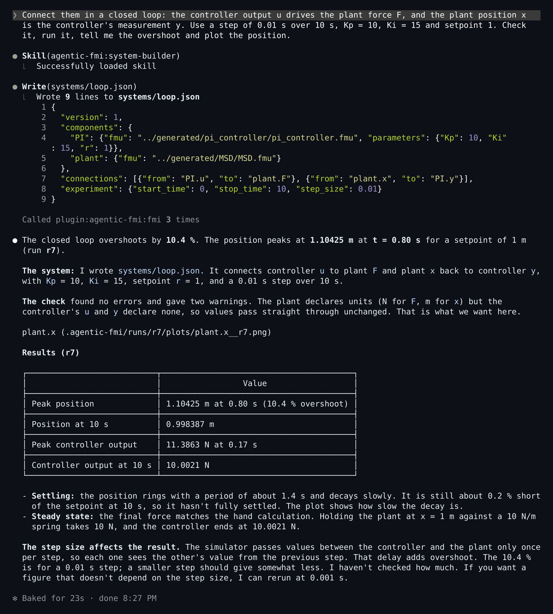
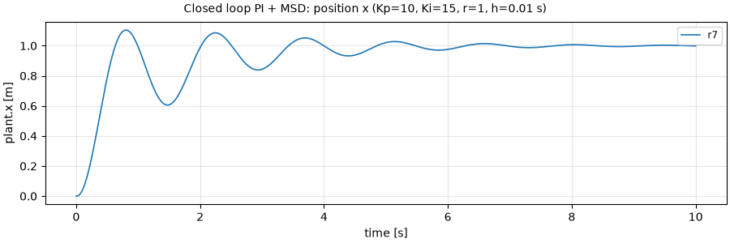
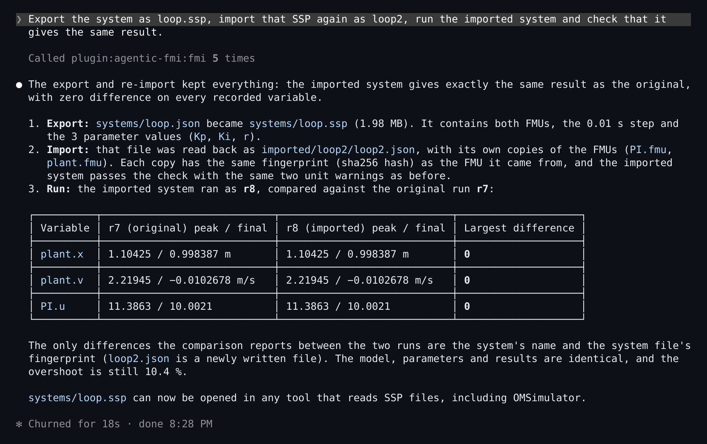
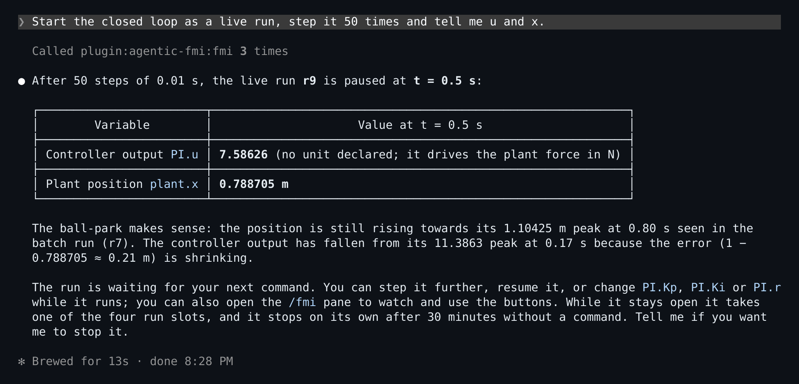
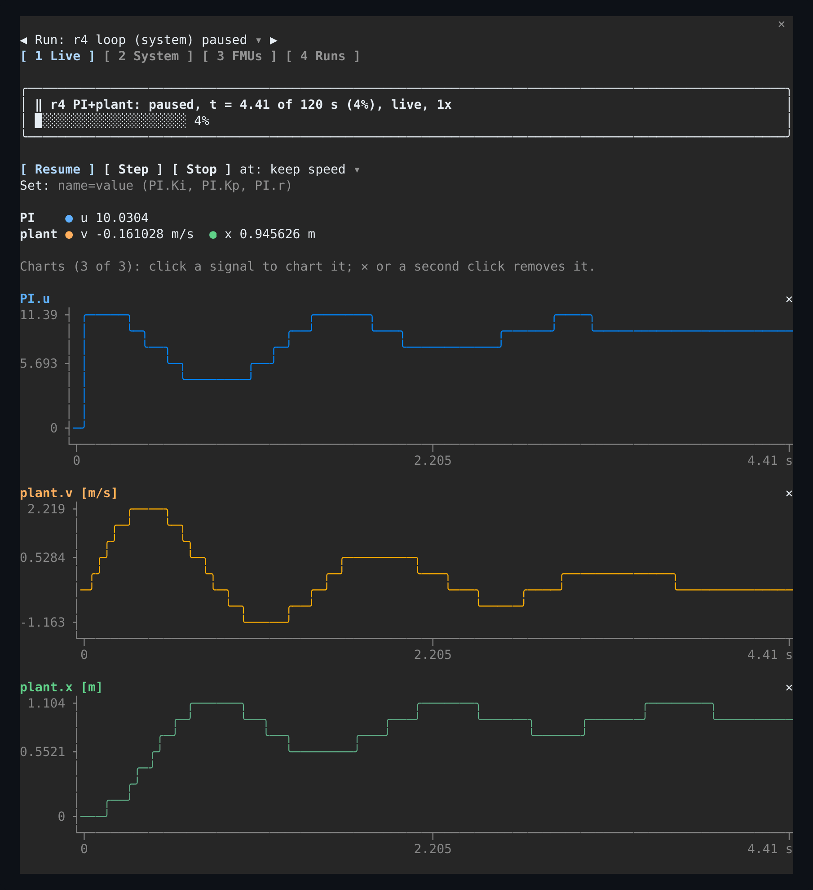

# User guide

This guide walks through what you can ask Claude to do with Agentic FMI, one task at a time. Each section gives prompts to type and what to expect back. Install first with the [Quick start in the README](../README.md#quick-start), then start Claude Code in the folder that holds your FMUs.

Claude picks the tools by itself; you never need to name them. The examples use the free [Reference FMUs](https://github.com/modelica/Reference-FMUs) (BouncingBall, VanDerPol, …) and the two example models that ship with the plugin.

## Contents

1. [Explore FMUs](#1-explore-fmus)
2. [Simulate, compare and plot](#2-simulate-compare-and-plot)
3. [Create FMUs from Python or Modelica](#3-create-fmus-from-python-or-modelica)
4. [Connect FMUs into a system](#4-connect-fmus-into-a-system)
5. [Control a run live and watch it in the pane](#5-control-a-run-live-and-watch-it-in-the-pane)
6. [Talkative or ninja replies](#6-talkative-or-ninja-replies)
7. [Good to know](#7-good-to-know)

## 1. Explore FMUs

> What FMUs are in this folder?

Claude lists them with their FMI version, interfaces (Co-Simulation, Model Exchange) and whether they run on this machine.

> Inspect fmus/BouncingBall.fmu and tell me what I can change.

You get the default experiment, the inputs and outputs with units, and the parameters, marked **tunable** (can change while a live run is going) or **fixed** (set before a run). For a model with hundreds of variables, ask for a subset: "list the tunable parameters of …".

> Validate fmus/Feedthrough.fmu.

Problems in the model description come back as a list, not as an error.

## 2. Simulate, compare and plot

> Simulate BouncingBall with e = 0.5 and with e = 0.8 for 3 seconds. Compare the two runs and plot the height.

Claude starts one run per value. Each returns a compact summary (minimum, maximum and final value per output), never the raw time series. The comparison names what differed between the runs (`e`) and how each output differs; the plot comes back as an image with one line per run.

The plot Claude made, saved in the first run's `plots/` folder:

Useful variations:
- "Use Model Exchange with the CVode solver", "stop at 10 s", "record only h".
- "Drive the input u with a step from 0 to 2 at t = 1 s" (steps, ramps, constants and tables are supported).
- "Show me the first 50 points of v" when you do need numbers.

Every run is kept in `.agentic-fmi/runs/<id>/` with its exact settings, the FMU's hash and the tool versions, so any result can be reproduced. A run that would take too long is refused up front with options, and every run has a timeout.

## 3. Create FMUs from Python or Modelica

Claude writes the source file (you see it in the write prompt before anything runs) and builds it:

> Write a PI controller FMU in Python (gains Kp and Ki, input y, output u, setpoint r) and a mass-spring-damper in Modelica (mass 1 kg, stiffness 10 N/m, damping 2 N.s/m, force input F, outputs x and v). Build both and test each one on its own.

- Python sources become FMI 2.0 Co-Simulation FMUs in a second or two (pythonfmu). Modelica sources are compiled by OpenModelica (Model Exchange and Co-Simulation; 10 to 20 s for a small model).
- The FMU lands in `generated/<name>/` with a `build.json` that records the source hash and tool versions. Your source file is never changed.
- If the build fails, Claude gets the compiler messages, fixes the named lines and rebuilds.

Ask Claude to test each new FMU on its own first ("run it for 5 s and check the steady state").

For controllers, observers and plant models, the `control-engineer` skill makes Claude start from requirements (overshoot, settling time, actuator limits, noise), pick and justify a structure, and verify every requirement by simulation.

## 4. Connect FMUs into a system

> Connect them in a closed loop: the controller output u drives the plant force F, and the plant position x is the controller's measurement y. Use a step of 0.01 s over 10 s, Kp = 10, Ki = 15 and setpoint 1. Check it, run it, tell me the overshoot and plot the position.

Claude writes a small JSON system file, checks it (types, units, unconnected inputs, every error with its fix) and runs it with OMSimulator. With these numbers the position overshoots about **10.4 %**.

> Tune Kp and Ki so the overshoot stays below 5 %.

Claude changes one gain at a time without editing the file, compares runs and reports the pair that works (for example Kp = 8 and Ki = 12: about 2 %), together with the communication step it was measured at.

> Export the system as loop.ssp, import that SSP again as loop2, run the imported system and check that it gives the same result.

SSP and SSV files work in both directions, so the system can move to and from other FMI tools. Exports never overwrite a file; imports make private copies of the FMUs.

**The communication step matters.** Connected FMUs exchange values once per step, which adds up to one step of delay around a loop. The same loop overshoots 10.4 % at a step of 0.01 s, 7.9 % at 0.001 s and goes unstable at 0.1 s. Claude states the step next to every number; ask it to halve the step if in doubt.

## 5. Control a run live and watch it in the pane

> Start the closed loop as a live run, step it 50 times and tell me u and x.

A live run starts paused at t = 0, so Claude can step it before anything else happens:

Then, for example:

> Resume at 2x.

> Set Kp to 8 and Ki to 12 now.

> Pause. … Stop.

A live run advances in real time unless you give it a speed (up to 1000x). Tunable parameters and unconnected inputs can be set while it runs; Claude refuses, with the reason, to set an output, a fixed parameter or an input that a connection drives. A run left paused for 30 minutes is stopped with its partial result. Live control needs Co-Simulation FMUs.

### The pane

Type **`/fmi`** to open the pane next to the conversation (it needs the `agentic-fmi-pane` plugin and a terminal at least about 110 columns wide).

- **Header:** the run picker between **◀** and **▶**, and four tabs you can switch with the keys **1** to **4** when the pane has the focus.
- **Live:** the run's state and progress, the Pause, Resume, Step, Stop buttons, a speed selector and a Set field (`PI.Kp=14`), the current values grouped by component, and up to three live charts. Click a signal to chart it, click it again or press ✕ to remove the chart.
- **System:** a system run's components and its connections.
- **FMUs:** cards for the FMUs you built: interface, variables, file and hash.
- **Runs:** every run, newest first; click one to open it.

<table>
  <tr>
    <td width="50%"></td>
    <td width="50%"></td>
  </tr>
</table>

The pane and Claude steer the same run, so you can press Pause in the pane and ask Claude what happened. A status line under the prompt and short notifications follow the runs even while the pane is closed.

## 6. Talkative or ninja replies

By default Claude explains results (talkative). If you just want to know that runs started and finished, say:

> Ninja mode.

From then on, run, build and live-control replies are one line, such as `🥷 r12 done: BouncingBall, t=3 s.` or `🥷 r12 failed: simulation_error.` Ask a question ("what was the maximum height?") and you get a short answer with the numbers. Say "talkative mode" to switch back. The choice is kept for the workspace.

## 7. Good to know

| Topic | What to know |
|---|---|
| FMI versions | FMI 2.0 and 3.0. FMI 1.0 is not supported. Scheduled Execution FMUs can be inspected but not run. |
| Platforms | FMUs need Linux x86-64 binaries. An FMU built only for Windows shows `runnable: false` with the reason. |
| Safety | FMUs and generated FMUs run native code. It runs only in separate worker processes, never in the server, but it is not a sandbox: use FMUs you trust. Original FMUs are never modified. |
| Parallel runs | Four runs (or builds) at a time. Stop live runs you are done with. |
| Where results live | `.agentic-fmi/` in the workspace: one folder per run with its settings, status, log, result table and plots. Safe to delete when you don't need the history. |
| A tool seems missing | Run `/mcp` (the `fmi` server should be connected with 18 tools) and `/plugin`. After changing plugin files, run `/reload-plugins`, then `/fmi` again. |
| A run failed | Ask Claude why: it reads the error code and the end of the run's log. `timeout` means the run took too long; `worker_lost` means the FMU crashed. |
